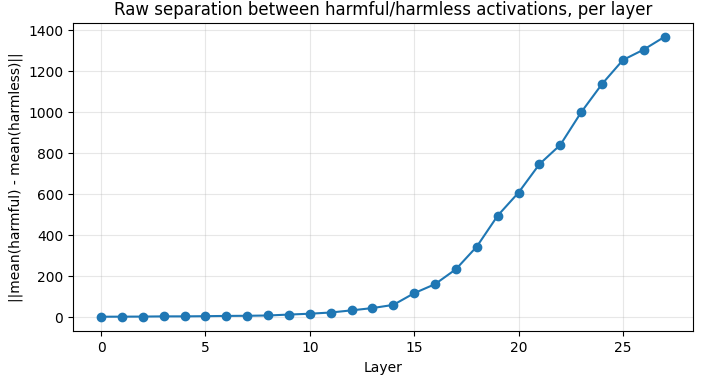

# Refusal Direction: Replicating Arditi et al. on Qwen3-1.7B

A replication of ["Refusal in Language Models Is Mediated by a Single Direction"](https://arxiv.org/abs/2406.11717) (Arditi et al., 2024) on **Qwen3-1.7B**, a model that came out after the original paper.

**Live report:** https://ali-mohamed843.github.io/refusal-direction-qwen3/
Original reference implementation: [andyrdt/refusal_direction](https://github.com/andyrdt/refusal_direction)

## TL;DR

- A difference-of-means direction computed from 32 harmful (AdvBench) and 32 harmless (Alpaca) prompts is enough to find a direction that controls refusal in Qwen3-1.7B.
- Removing that direction from the residual stream (direction taken from layer 12, ablated at every layer) cut refusals on 100 held-out harmful prompts from **81% to 4%**. Refusals on 100 held-out harmless prompts stayed at **0%**.
- Adding the direction back to induce refusal only partly worked (see below).
- Refusals are detected by keyword matching, not by a classifier or manual grading. Read the Limitations section before relying on the numbers.

## Method

1. Run 32 harmful and 32 harmless instructions through the model. Cache the residual stream at the **last prompt token** for all 28 layers.
2. For each layer, compute `direction = mean(harmful) - mean(harmless)`, normalized to unit length. This gives 28 candidates.
3. Ablate each candidate (`x' = x - (x . d) d`, applied at every layer) and measure, on a validation set (32 harmful, 32 harmless), how often harmful prompts are answered and how often harmless prompts are refused.
4. Select the layer using the validation set only. Report final numbers on a separate test set (100 harmful, 100 harmless) that played no part in selection.

## Results

### Held-out test set (100 harmful, 100 harmless prompts)

| Condition                    | Harmful prompts refused | Harmless prompts refused |
|------------------------------|-------------------------|--------------------------|
| Baseline (no intervention)   | 81%                     | 0%                       |
| Direction ablated (layer 12) | 4%                      | 0%                       |

With 100 prompts per condition, approximate 95% intervals are 72-88% for the baseline harmful refusal rate and 2-10% for the ablated one.

### Layer sweep (validation set)

From layer 12 to layer 27, ablating the direction gave a 100% non-refusal rate on the 32 validation harmful prompts, with 0% refusals on harmless prompts at every layer. Layers 0-11 were weaker (0.1 to 0.8). Layer 12 was chosen as the earliest layer to reach 100%. Because validation saturates, this is "earliest layer that works", not a finely tuned optimum.


### Where the signal appears



This plot shows the raw L2 distance between the mean harmful and mean harmless activations per layer. It grows with depth, but residual-stream norms also grow with depth, so it is not a normalized measure of separation. It shows the two prompt types are represented differently in later layers; the ablation sweep is what shows the direction matters causally.

### Inducing refusal (activation addition)

| Coefficient | Induced refusal rate (keyword detector) |
|-------------|------------------------------------------|
| 4           | 100%                                     |
| 8           | 0%                                       |
| 12          | 0%                                       |
| 16          | 0%                                       |

At coefficient 8 and above the model produces repeated, off-topic fragments (e.g. "SECURITY POLICY", "NOT AUTHORIZED") instead of answers. The keyword detector counts this as "no refusal", so the 0% values mean the output broke, not that the model complied. The symmetric claim of the original paper is therefore only partly reproduced here: coefficient 4 produced refusals, larger values broke coherence. A finer sweep between 4 and 8 is future work.

## Limitations

- **Refusal is detected by keyword matching.** "Not refusing" is not the same as "giving a harmful answer". Some ablated outputs in the report still lecture or redirect without using refusal keywords. Compliance has not been graded manually or with a classifier.
- **Small and single-run.** 32 + 32 prompts for the direction, 32 + 32 for validation, 100 + 100 for testing, one model, one run, no seeds compared.
- **Capability preservation was not measured.** Only the refusal rate on harmless prompts was checked. Nothing here shows that general ability is unchanged.
- **Validation saturates**, so layer selection cannot distinguish layers 12-27.
- **Activation addition** was swept coarsely and judged with the same keyword detector.
- One 1.7B model is one more data point, not evidence about all models.

## Repo structure

```
notebooks/
  00_setup.ipynb       # load Qwen3-1.7B in TransformerLens, verify activations
  01_data.ipynb        # build harmful/harmless datasets and splits
  02_direction.ipynb   # compute and select the refusal direction
  03_ablation.ipynb    # direction ablation (jailbreak)
  04_induction.ipynb   # activation addition (induce refusal)
images/                # figures used in the report
index.html             # the report (served via GitHub Pages)
```

## Reproduce

- Model: `Qwen/Qwen3-1.7B`
- Environment: Google Colab, T4 GPU
- Library: TransformerLens 3.0 (`TransformerBridge`)
- Data: AdvBench (harmful), Alpaca (harmless)
- Run the notebooks in order. Install dependencies from the first cell of `00_setup.ipynb`.

## Responsible use

Directional ablation is a known technique described in the original paper. This repo does not release modified model weights, and the report keeps harmful examples short and non-operational. The goal is to understand how refusal is represented, not to distribute a jailbroken model.

## Citation

```
@article{arditi2024refusal,
  title={Refusal in Language Models Is Mediated by a Single Direction},
  author={Andy Arditi and Oscar Obeso and Aaquib Syed and Daniel Paleka and Nina Panickssery and Wes Gurnee and Neel Nanda},
  journal={arXiv preprint arXiv:2406.11717},
  year={2024}
}
```

## License

Add a `LICENSE` file (MIT is a common choice for research code).
